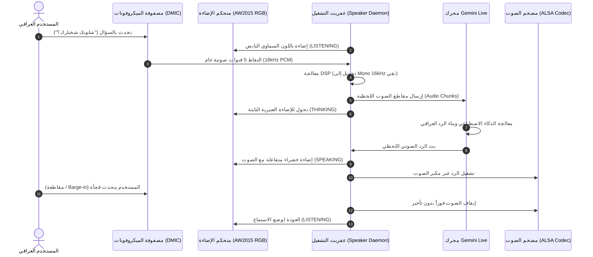
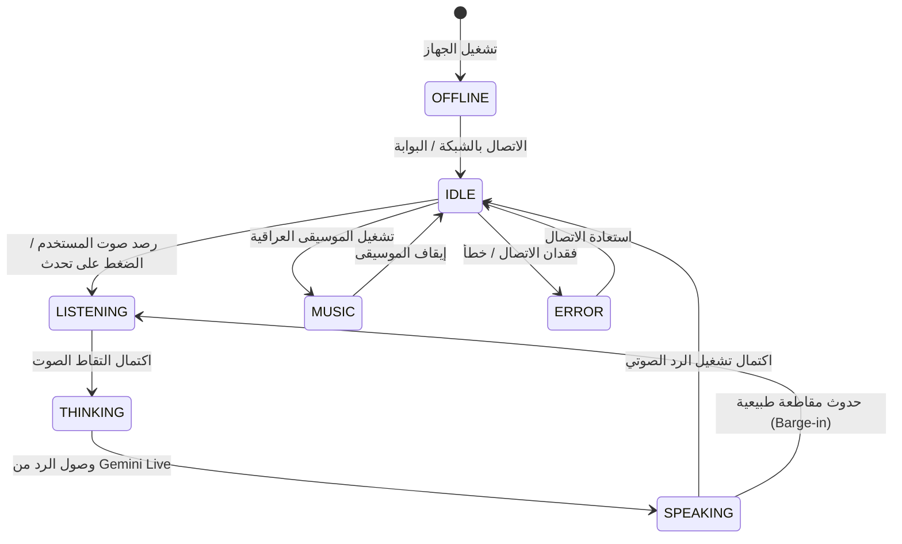

# بنية المنظومة والتصميم الهندسي (System Architecture & Security Specification)
## مشروع المساعد الصوتي العراقي الذكي (Iraqi AI Smart Speaker)

---

## 1. الهيكل العام للـ Monorepo

```text
/iraqi-ai-smart-speaker
├── /android-app             # تطبيق التحكم الأصلي (Kotlin + Jetpack Compose Material 3)
│   ├── /app/src/main/java   # Presentation, Domain, Data, Connectivity, Gemini Client
│   └── /app/src/main/res    # الموارد، الثيمات، وسلاسل النصوص العربية RTL
├── /speaker-runtime         # عفريت التشغيل على نظام لينكس المدمج (Python/C Socket Server)
├── /firmware-adapters       # طبقة التجريد العتادي للوحة Ingenic X1800 ومتحكم AW2015 RGB
├── /backend                 # خادم البوابة وإدارة الجلسات اللحظية ورموز التوثيق المؤقتة
├── /shared-protocol         # مخطط الإعدادات الموحد (JSON Schema) ومجاميع التحقق SHA-256
├── /tools                   # أدوات الفحص العتادي التلقائي (Speaker Scanner) والتهيئة
├── /tests                   # حزمة الاختبارات الآلية للوحدات والبروتوكول والتكامل
└── /docs                    # التوثيق الهندسي، تقارير التوافق، وإرشادات الأمان
```

---

## 2. مخطط تدفق البيانات والتفاعل الصوتي (Sequence Flow)



---

## 3. مخطط آلة الحالات لإضاءة الـ RGB (RGB State Machine)



---

## 4. نموذج الأمان وإدارة المفاتيح التشفيرية (Security Architecture)

1. **حظر المفاتيح الثابتة:**
   * لا يحتوي ملف الـ APK النهائي أو شفرة المصدر المفتوحة على أي مفاتيح خاصة لـ Gemini API.
2. **بروتوكول الرموز المؤقتة (Ephemeral Token Exchange):**
   * يقوم تطبيق الهاتف بطلب رمز وصول مؤقت مدته 60 دقيقة من مسار `/api/v1/auth/token` في خادم البوابة الخلفي، مما يحمي الحسابات من التسريب.
3. **أمان الذاكرة وتشفير الإعدادات:**
   * كلمات مرور الـ Wi-Fi والبيانات الحساسة تُحفظ في `Android Keystore` مشفرة بنظام AES-256، ولا تُطبع أبداً في سجلات النظام (`Logs`).
4. **تكامل البيانات وسلامة التكوين (Checksum Verification):**
   * كل إرسال لإعدادات الشخصية أو الصوت يتم تذييله بمجموع تحقق تشفيري `SHA-256`. إذا حدث أي تلاعب بالملف في الطريق، ترفض السماعة اعتماده فوراً وتطلب إعادة المزامنة.
